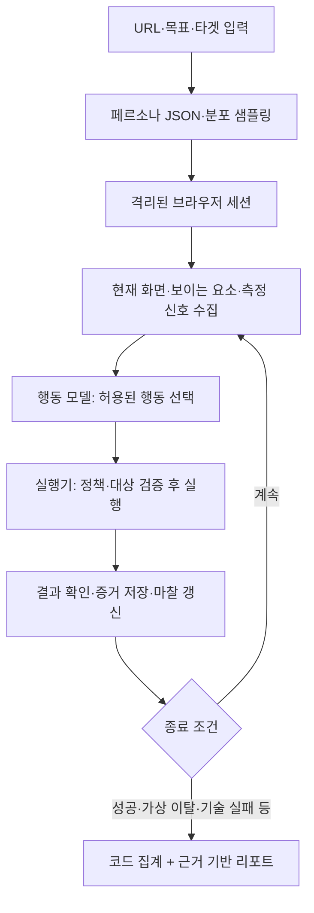

# DropSpot AI 구현 가능성 검토

- 검토일: 2026-11-03
- 기준 기획서: `D:\DropSpot_4호선톤_제안보고서 (3).pdf`, 전체 21쪽
- 핵심 검토 범위: 기능·페르소나·아키텍처·좌절 모델·MVP 계획(7~12, 18~20쪽)
- 상태: 기획서와 공식 기술 문서를 바탕으로 한 설계 검토. 모델 호출, 브라우저 실행, 비용·정확도 실측은 수행하지 않았다.

## 1. 결론

**DropSpot의 해커톤 MVP는 자체 LLM 학습 없이 구현할 수 있다.** 기존 멀티모달 모델에 브라우저 도구, 페르소나별 행동 제약, 마찰 신호 수집, 종료 규칙, 근거 기반 리포트를 연결하는 것이 핵심이다.

다만 구현 가능한 것은 우선 **“가상 사용자 조건에서 발견되는 UX 마찰과 이탈 가설”**이다. “실제 고객 46%가 회원가입에서 이탈한다” 같은 예측의 정확도는 별도 문제다. 인내심 수치를 넣어 에이전트를 포기하게 만들 수는 있지만, 그 수치가 실제 사람을 대변한다는 근거는 자동으로 생기지 않는다.

권장 순서는 **기존 모델 + 하네스 → 반복 실행 평가 → 실사용자 검증 → 통계적 보정 → 필요할 때만 파인튜닝**이다.

기획서 6쪽의 ‘실사용자 테스트 전 1차 스크리닝’ 포지셔닝이 현재 구현 가능성과 가장 잘 맞는다. 참고 연구 UXAgent도 실제 사람 대상 연구 전에 테스트 설계를 점검하는 용도를 설명하며, 사람의 이탈률을 정확하게 예측한다는 근거로 바로 사용할 수는 없다. [UXAgent 원문](https://arxiv.org/abs/2504.09407)

## 2. 먼저 구분할 개념

| 구분 | 의미 | DropSpot 예시 | 자체 모델 학습 |
|---|---|---|---|
| 기존 모델 활용 | 이미 학습된 모델을 API로 호출 | 화면 이해, 다음 행동 선택, 원인 설명 | 불필요 |
| 프롬프트·예시 제공 | 역할·출력 형식·판단 예시 전달 | 페르소나와 7개 원인 분류 기준 주입 | 불필요 |
| 검색·RAG | 필요한 근거를 찾아 문맥에 제공 | 고객 인터뷰, 리뷰, UX 규칙, 세션 로그 | 불필요 |
| 하네스 엔지니어링 | 모델 주변의 관찰·도구·상태·제약·검증·실행 관리 구현 | 클릭 제한, 마찰 점수, 증거 저장, 재시도, 비용 상한 | 불필요 |
| 통계적 보정 | 관측 데이터로 수치 모형의 계수 추정 | 가입 단계의 이탈 위험 가중치 보정 | 데이터 기반 피팅 필요, LLM 재학습은 불필요 |
| 파인튜닝 | 기존 모델의 가중치를 추가 데이터로 변경 | 한국어 UX 원인 분류기 개선 | 필요 |
| 처음부터 사전학습 | 기반 모델 자체를 구축 | 자체 브라우저·언어 모델 개발 | 현재 범위에서 권장하지 않음 |

‘학습 없이’는 구현 공부나 평가 없이 된다는 의미가 아니다. 브라우저 자동화, 상태 관리, 모델 출력 검증, UX 평가 기준을 개발팀이 익히는 작업은 필요하다.

## 3. 활용 가능한 모델과 도구

### 3.1 후보 비교

아래 모델은 도입 후보이며 DropSpot에서 성능이 검증된 순위가 아니다. 실제 API 계정 접근 가능 여부, 정확한 모델 ID, 프레임워크 호환성은 구현 때 확인한다. 모델명과 제공 상태는 변경될 수 있다.

| 후보 | 맡길 역할 | 선택 이유·확인할 점 |
|---|---|---|
| OpenAI GPT-6.1 Sol (`gpt-6.1-sol`) | 브라우저 행동 선택, 복잡한 화면 해석, 종합 리포트 | 공식 문서에서 이미지 입력·도구·computer use 지원 확인. 초기 품질 기준선 후보 |
| OpenAI GPT-6.1 Terra (`gpt-6.1-terra`) | 화면 기반 행동 선택 비교 실험 | 공식 모델 목록에서 시각 추론·computer use 용도로 소개. Sol과 실제 과업 비용·실패율 비교 |
| OpenAI GPT-6 Luna (`gpt-6-luna`) | 페르소나 JSON 생성, 단순 분류, 로그 요약 | 대량 처리 후보. 행동 실행까지 맡길지는 별도 평가 |
| Claude Sonnet 계열 | 브라우저·화면 기반 실행의 대안 | 공식 computer use 도구 제공. 도구 규격과 실행 환경을 맞춰야 함 |
| Gemini Flash 계열, 공식 목록의 Gemini 3.8 Flash 등 | 페르소나 생성, 구조화 추출, 브라우저 실행 비교 | Flash 모델 후보와 구조화 출력 지원 문서를 확인. 선택 버전의 이미지·도구 기능을 개별 확인 |
| Browser Use의 BU 2.0 | 브라우저 탐색 전용 후보 | 공급자가 브라우저용으로 제공하는 모델. 과업 완수 성능과 페르소나 준수 성능을 구분해서 평가 |

모델 기능의 근거: [OpenAI 모델 목록](https://developers.openai.com/api/docs/models), [OpenAI computer use](https://developers.openai.com/api/docs/guides/tools-computer-use), [Claude computer use](https://platform.claude.com/docs/en/agents-and-tools/tool-use/computer-use-tool), [Gemini 모델 목록](https://ai.google.dev/gemini-api/docs/models), [Gemini 구조화 출력](https://ai.google.dev/gemini-api/docs/structured-output), [Browser Use 모델 선택](https://browser-use.com/custom-models).

추천 출발점은 **행동 판단용 모델 1개 + 간단한 생성·요약용 저비용 모델 1개**다. 처음부터 모든 공급자를 붙이기보다 한 조합으로 추적 가능한 실행을 만든 뒤 비교한다. Sol/Terra 중 행동 모델을 평가하고 Luna를 보조 후보로 두는 조합이 한 출발점이며, 기존에 쓸 수 있는 Claude/Gemini 계정이 있다면 같은 평가 과업으로 비교하면 된다. 이는 설계 제안이며 우월성 실측 결과는 아니다.

### 3.2 모델이 아닌 구성 요소

| 도구 | 역할 | 판단 |
|---|---|---|
| Playwright | 브라우저 실행, DOM·화면·영상·네트워크 관찰, 클릭·입력 | 핵심 실행 기반 후보 |
| Browser-Use | 모델과 브라우저를 연결하는 에이전트 프레임워크 | 빠른 프로토타입 후보. 관찰·행동 훅과 종료 정책 제어 가능 여부 검증 필요 |
| JSON Schema + Pydantic/Zod | 페르소나·행동·원인 출력 검증 | 프롬프트만으로 형식을 유지하려는 방식보다 견고한 구현에 유리 |
| 접근성 검사 도구, 예: axe-core | 규칙으로 판정 가능한 일부 접근성 문제 수집 | 주관적 화면 평가와 분리. 도입 시 공식 규칙·적용 범위 확인 |
| PostgreSQL·객체 스토리지 | 이벤트, 페르소나, 스크린샷·영상 보관 | 초기에는 관계형 저장과 파일 저장으로 시작 가능 |
| Redis 기반 큐 | 실행 대기열, 동시 실행 수 제한, 실패 관리 | 수십 세션 운영 단계에서 필요 |

구조화 출력은 스키마 준수를 돕지만 내용의 진실성을 보장하지 않는다. 존재하지 않는 버튼이나 근거 스텝은 실행기가 다시 검증해야 한다. [OpenAI 구조화 출력](https://developers.openai.com/api/docs/guides/structured-outputs)

## 4. 기능별로 어디까지 가능한가

판정의 ‘높음’은 구현 가능성을 뜻한다. 실제 고객 행동을 대변하는 타당성까지 높다는 뜻은 아니다.

| 기획 기능 | 학습 없이 가능한 범위 | 하네스에서 구현할 것 | 데이터·학습이 필요한 지점 | 판정 |
|---|---|---|---|---|
| 자연어 → 페르소나 | 속성·목표·제약을 JSON으로 생성 | 값 범위 검증, 분포 샘플링, 충돌 조건 검사 | 실제 고객군 분포와 행동 특성 보정 | 높음 |
| 4개 세그먼트 패널 | 템플릿 + 수치 변동으로 생성 | 비율·기기·시드 관리 | 세그먼트 대표성 검증 | 높음 |
| URL에서 웹 탐색 | DOM·스크린샷 기반 클릭·입력 | 세션 격리, 행동 검증, 제한된 도구 | 일반 사이트 안정성은 실행 평가 필요 | 제한된 사이트에서 높음 |
| 모바일·느린 네트워크 | 뷰포트와 네트워크 조건 부여 | 조건별 측정·실행 분리 | 실제 손동작·시력·인지 부하는 별도 검증 | 부분 가능 |
| Think-aloud | 관찰과 행동에 연결된 가상 발화 생성 | 증거 ID, 관찰과 추론 구분 | 실제 사람의 발화·감정과 일치하는지는 검증 필요 | 생성은 높음 |
| 좌절·이탈 판정 | 수식과 임계치로 동작 구현 | 객관 신호 수집, 누적 점수, 종료 판정 | 사람 이탈률과 맞추려면 실제 데이터 필요 | 시뮬레이션 높음, 예측 미검증 |
| 7개 원인 분류 | 규칙 + LLM 분류 | 다중 원인, 불명 처리, 증거 검증 | 분류 오류가 반복되면 라벨 데이터로 개선 | 높음 |
| 퍼널·히트맵 | 실행 이벤트를 코드로 집계 | 단계 정의, 분모·종료 상태 관리 | 실고객 비율 해석에는 대표성·보정 필요 | 높음 |
| 개선안 Top 3 | 관찰된 문제에 맞는 개선 가설 생성 | 빈도 계산, 근거 연결, 중복 제거 | 실제 효과는 배포 후 실험 필요 | 높음 |
| 세션 리플레이 | 실행 영상·스크린샷 저장 | 타임라인 동기화, 민감정보 처리 | 자체 모델 학습 필요 없음 | 높음 |
| 에이전트 인터뷰 | 해당 세션 로그를 검색해 답변 | 미관찰 내용 답변 제한, 근거 링크 | 실제 고객 인터뷰 대체 여부는 검증 불가 | 높음, 해석 제한 |
| 개선 전후 비교 | 같은 조건으로 반복 실행 | 데이터 초기화, 버전 고정, 결과 분산 기록 | 실전환 개선 효과는 실제 A/B 검증 | 높음 |
| 한국형 가입·결제 | UI 노출·입력 단계의 마찰 점검 | 테스트 계정, 모의 인증·결제, 도달 판정 | 실제 인증 성공·구매 의사 재현은 별도 영역 | 부분 가능 |
| GA4 보정 | 단계별 결과 차이를 수치로 비교 | 실제·합성 퍼널 정의 정렬, 데이터 분리 | 계수 피팅, 외부 검증 필요 | 후속 단계 |
| Figma·모바일 앱 | 별도 실행 어댑터로 확장 가능성 | 좌표·화면·상태·성공 판정 재구축 | 웹에서의 성능을 그대로 가정할 수 없음 | MVP 후순위 |

## 5. 하네스 엔지니어링으로 해결할 핵심

하네스는 모델이 어떤 화면을 보고, 무엇을 기억하며, 어떤 행동을 할 수 있고, 언제 중단하며, 결과를 어떻게 검증할지 정하는 실행 시스템이다. 페르소나 설명을 프롬프트에 넣는 것만으로 충분하지 않다.

### 5.1 권장 실행 구조



### 5.2 페르소나는 실행 제약으로 만든다

- 인내심: 허용 대기 시간·되돌아가기 횟수·입력 부담 예산으로 구현한다.
- 가격 민감도: 예상 총액과 새로 드러난 비용의 차이를 마찰 신호로 기록한다.
- 숙련도: 사용할 수 있는 행동 종류·탐색 예산을 명시한다. 내부 API나 개발자 도구로 우회하면 사용자 시뮬레이션이 무너진다.
- 정보 접근: 초기 화면에서 보이지 않는 배송비나 DOM에 숨겨진 버튼을 모델이 미리 알지 못하도록 관찰을 제한한다.
- 저숙련·접근성: 나이만으로 행동을 정하지 않고 직접 지정한 기능적 조건을 사용한다. 조건의 현실성은 실제 사용자 검증 대상으로 남긴다.

특히 DOM을 전부 읽는 에이전트는 화면 밖 CTA도 쉽게 찾을 수 있다. 가시 영역, 스크롤 상태, 접근성 정보의 전달 범위를 설계하고 시각 과업은 스크린샷으로 교차 확인해야 한다.

### 5.3 모델 출력과 실행 결과를 분리한다

행동 모델은 `action`, `target_id`, `expected_result` 등을 반환하고, 실행기가 대상의 존재·가시성·허용 여부를 확인한다. 행동 후에는 URL·화면 상태·이벤트로 실제 결과를 확인한다. 모델이 ‘가입 완료’라고 말한 것만으로 성공 처리하지 않는다.

화면 안의 텍스트는 테스트 대상 데이터다. 사이트가 에이전트에게 다른 지시를 하거나 비밀을 요구해도 상위 정책을 바꿀 수 없도록 도구와 정보 접근을 제한한다.

### 5.4 사용자 마찰과 에이전트 오류를 구분한다

최소한 다음 종료 상태를 별도로 저장한다.

| 상태 | 의미 | 집계 방식 |
|---|---|---|
| `success` | 정의한 목표 상태 도달 | 성공 건수 |
| `simulated_dropout` | 설정된 행동 모형에 따라 포기 | 가상 이탈 건수 |
| `agent_failure` | 잘못된 도구 호출, 모델 반복 등 | 실행 품질 지표 |
| `site_failure` | 사이트 오류로 진행 불가 | 사이트 기술 이슈로 별도 표시 |
| `blocked_auth` | CAPTCHA·실인증 등 미지원 경계 | 도달·차단 건수 |
| `budget_exceeded` | 시간·토큰·스텝 상한 초과 | 미완료 건수 |

전체 시작 세션 수와 각 종료 상태 수를 함께 보여준다. 기술 실패를 제외한 비율을 추가 제공한다면 분모와 제외 건수를 반드시 명시한다. 에이전트 클릭 실패를 고객 이탈로 계산하면 안 된다.

### 5.5 재시도는 목적별로 제한한다

일시적인 API 오류는 재시도할 수 있지만, 사용자가 버튼을 못 찾는 상황을 에이전트가 무제한 재탐색해서 해결하면 마찰이 사라진다. 인프라 복구 재시도와 사용자 행동 재시도를 분리하고 각각 기록한다.

### 5.6 증거를 먼저 저장하고 설명을 생성한다

모든 이슈는 `run_id`, `session_id`, `step_id`, 화면·요소 정보와 연결한다. ‘가입 필드가 많음’ 같은 관찰, ‘인내심 예산을 초과함’ 같은 모형 판정, ‘실사용자가 부담을 느낄 수 있음’ 같은 가설을 분리한다.

Think-aloud는 모델이 만든 역할 기반 설명이며 실제 사람의 생각이나 모델 내부 추론을 측정한 데이터가 아니다. 세션 인터뷰도 관찰하지 않은 이유에 대해서는 ‘로그만으로 확인할 수 없음’이라고 답하게 한다.

## 6. 좌절 모델: 구현과 타당성의 차이

기획서 12쪽의 수식은 그대로 코드로 구현할 수 있다.

```text
F_t = delta * F_(t-1) + sum(w_k * c_k(t)) - reward_t
P_t = sigmoid(beta * (F_t - tau * M))
```

하지만 `w`, `tau`, `M`, `beta`의 초기값이 임의라면 결과는 **그 설정에서의 시뮬레이션**이다. LLM이 정한 점수를 더한다고 실제 이탈 확률이 되지 않는다.

초기에는 다음 방식이 낫다.

1. 필드 수, 추가 비용 노출, 되돌아가기, 오류, 사이트 응답 지연 등 측정 가능한 이벤트를 수집한다.
2. ‘가치가 모호하다’ 같은 해석 신호는 LLM 판단과 증거를 함께 저장한다.
3. 가중치·임계치는 설정 파일로 관리하고 결과에 모형 버전을 남긴다.
4. 낮음·기본·높음의 인내심 조건에서 결과가 얼마나 바뀌는지 민감도 분석을 한다.
5. 조건을 조금만 바꿔도 순위가 뒤집히는 이슈는 불안정한 가설로 표시한다.

확률을 매 클릭마다 적용하면 행동 스텝이 많은 에이전트가 더 자주 포기하는 편향이 생긴다. 확률 판정의 단위를 사용자 의사결정 이벤트 또는 정해진 시간 단위로 명시해야 한다. 또 LLM 응답 시간과 실제 페이지 로딩 지연을 분리하고, 대기 시간이 길어 API가 느렸던 것을 사이트 마찰로 계산하지 않는다.

기획서의 ‘시드 고정’은 패널 샘플링과 모형 난수의 비교 조건을 맞추는 데 도움이 된다. 모델 추론·사이트 응답·동적 콘텐츠까지 완전히 동일하게 만들지는 못한다. 같은 패널을 여러 번 실행하고 모델·프롬프트·사이트·설정 버전을 기록해야 한다.

## 7. 실제 데이터가 있어야 풀리는 부분

| 목표 | 필요한 데이터 | 먼저 시도할 방법 | LLM 파인튜닝 필요성 |
|---|---|---|---|
| 단계별 실제 이탈률 보정 | 일관된 단계 정의의 노출·도달·이탈, 유입·기기·고객군 정보 | 단순 기준선과 비교하며 로지스틱 회귀·생존 모형 등 검토 | 초기에는 낮음 |
| 가격·입력 부담의 영향 추정 | 마찰 조건과 이후 행동이 함께 기록된 관측·실험 데이터 | 계수 피팅, 교란 변수 점검, 가능하면 실제 A/B 실험 | 낮음 |
| 원인 분류 개선 | 사람이 근거를 보고 라벨링한 이슈·비이슈·불명 사례 | 규칙·프롬프트·예시 개선 후 작은 분류기 비교 | 반복 오류가 남으면 검토 |
| 행동 정책 개선 | 좋은·나쁜 실행 궤적과 전문가 평가 | 도구·관찰·예산 개선, 궤적 비교 | 충분한 데이터 후 검토 |
| 실제 감정·구매 의사 검증 | 실제 사용자 과업·인터뷰·구매 행동 | 사람 대상 연구 | 파인튜닝만으로 대체 불가 |

GA4 단계별 합계만으로 숨은 비용·인증·가격·유입 차이 각각의 원인을 식별하기는 어렵다. 처음에는 고객사별 전체 위험도 보정처럼 작은 목표로 시작하고, 데이터가 허용하는 범위를 넘겨 계수를 해석하지 않는다.

학습·보정용 데이터와 평가용 데이터는 고객사·사이트·기간 단위로 분리한다. 같은 데모 사이트에서 계수를 맞추고 같은 사이트로 정확도를 발표하면 일반화 성능을 알 수 없다. 같은 기반 모델로 생성한 합성 세션 수를 늘리는 것도 독립적인 실제 사용자 증거를 늘리는 것과 다르다.

## 8. 해커톤 MVP 권장 범위

### 반드시 구현

- 팀이 통제하는 데모 웹사이트 1개와 문제·개선 버전.
- 페르소나 4종, 총 8~20세션. 동시 실행은 2~4개부터 실측 후 확대.
- 고정 과업 1개: 상품 탐색 → 장바구니 → 가입 또는 비회원 경로 → 모의 주문 완료.
- 마찰 3종: 강제 가입, 뒤늦은 배송비 노출, 찾기 어려운 CTA.
- 행동·화면·마찰 이벤트 저장과 근거를 클릭해 볼 수 있는 리포트.
- 단계별 도달 수, 종료 상태, 원인 가설, 개선안 Top 3.
- 같은 조건에서 개선 전후 반복 실행.

### 후순위

임의 사이트 100개 지원, 수백 동시 세션, 실제 PASS·결제, Figma·네이티브 앱, GA4 자동 보정, 고도화된 인터뷰·협업 도구 연동은 후순위로 둔다. ‘URL만 넣으면 모든 사이트에 자동 적용’은 데모 사이트 지원보다 범위가 훨씬 크다.

브라우저 자동화와 진단 정책을 한꺼번에 추상화하기보다 한 세션이 끝까지 추적되게 만든 다음 병렬화를 붙인다. 초기 로그 검색은 세션·스텝 ID 조회만으로도 시작할 수 있어 벡터 DB가 필수는 아니다.

### 완료 기준 제안

다음 수치는 합격 기준 제안이며 실측 결과가 아니다.

| 평가 | 기준 제안 |
|---|---|
| 실행 안정성 | 지원 과업 20세션 중 기술적 정상 종료 18세션 이상. 가상 이탈도 정상 종료에 포함 |
| 문제 탐지 | 심은 3종 문제 각각에 실제 화면·행동 증거 존재 |
| 오탐 확인 | 문제가 없는 대조 경로에서도 실행해 지어낸 이슈 수 별도 보고 |
| 근거 완전성 | 표시한 모든 이슈에 접근 가능한 스텝·화면 링크 제공 |
| 개선 확인 | 개선 전후 최소 3회씩 비교, 범위·분산과 상태별 건수 표시 |
| 정책 준수 | 결제·실인증 경계를 넘거나 페르소나 예산을 무시한 행동 별도 집계 |

‘심은 문제를 찾음’, ‘기술적으로 실행됨’, ‘실제 사람과 일치함’은 서로 다른 평가다. 마지막 항목은 파일럿에서 실제 사용자와 문제 위치·심각도 순위의 일치도를 확인해야 한다.

## 9. 비용·시간과 요금제 가능성

기획서의 100명·동시 20세션·약 35분은 목표치다. 현재 근거만으로 달성 여부를 확정할 수 없다.

```text
전체 모델 비용 = 모든 호출의 (입력 토큰 비용 + 출력 토큰 비용 + 이미지 처리 비용)
실행 원가 = 모델 비용 + 브라우저 실행 비용 + 저장·전송 비용 + 재시도 비용
대략적 실행 시간 = ceil(세션 수 / 동시 실행 수) * 평균 세션 시간 + 준비·분석 시간
```

예를 들어 20세션 × 평균 25스텝 × 스텝당 1회 호출이면 행동 판단만 500회 호출이다. 성찰·평가를 매번 별도 모델로 호출하면 호출 수가 늘어난다. 이는 산식 예시이며 예상 원가 실측값이 아니다.

비용 제어는 필요한 화면만 전달하기, 반복 문맥 줄이기, 간단한 집계는 코드로 하기, 세션 예산 상한 두기부터 적용한다. 캐시는 사이트 버전·기기·권한·사용자 상태·페르소나 조건이 같은 범위에서만 검토한다. 서로 다른 페르소나의 행동 경로를 강제로 재사용하면 비교 의미가 약해진다.

Free 10명·Starter 50명·Growth 200명이라는 요금 설계는 정상 실행 평균과 긴 꼬리 비용을 측정한 후 재검토해야 한다. 초기는 인원뿐 아니라 최대 스텝·실행 시간·모델 등급으로 크레딧 소모를 정의하는 편이 원가 관리에 유리하다.

## 10. 기획서에서 표현을 조정할 부분

| 현재 표현·설계 | 권장 표현·보완 |
|---|---|
| ‘이탈 예측 엔진’ | MVP에서는 ‘페르소나 기반 UX 마찰 진단·이탈 가설 시뮬레이터’로 설명 |
| ‘100명 중 46% 이탈’ | ‘설정된 가상 패널에서 관측된 이탈 비율’. 실제 고객 예측과 분리 |
| ‘발화로 왜 이탈했는지 파악’ | ‘관찰 근거와 모형에 기반한 원인 가설’. 인과가 확정된 것처럼 설명하지 않음 |
| ‘시니어·접근성 사용자 재현’ | ‘명시된 시각·탐색·조작 제약 조건을 점검’. 실제 사용자 경험 검증은 별도 |
| ‘동일 시드로 개선 증명’ | ‘조건을 맞춘 반복 시뮬레이션에서 변화 확인’. 실전환 개선은 실험 필요 |
| ‘18% → 34% 개선’ | 기획서의 가상 예시임을 유지. 데모 실측값과 섞지 않음 |
| ‘마찰 가중치가 데이터 해자’ | 실제 행동과의 연결·외부 평가가 축적될 때 경쟁력으로 주장 |

한국형 인증·결제는 기획서의 안전 원칙대로 소유가 확인된 테스트 환경과 모의 흐름에서 다룬다. 네트워크 수준에서도 내부 주소 접근·허용되지 않은 도메인 이동을 차단하고, 사이트가 외부로 리다이렉트되는 경우까지 통제해야 한다. 이는 사용자가 URL을 입력하는 서버 실행 제품의 구현 항목이다.

## 11. 추천 실행 순서

1. **한 세션 실행:** 현재 화면 관찰 → 제한된 행동 → 실행 결과 확인 → 증거 저장까지 만든다.
2. **페르소나 제약:** 입력·대기·탐색 예산과 3종 마찰 이벤트를 연결한다.
3. **리포트:** 종료 상태를 분리하고 모든 원인 가설에 근거 링크를 단다.
4. **반복 비교:** 문제·개선·문제 없는 대조 경로에서 반복해 안정성과 오탐을 측정한다.
5. **소규모 병렬화:** 큐와 비용 상한을 붙이고 실제 시간·비용을 기록한다.
6. **모델 비교:** 같은 사이트·과업·패널 조건에서 실행 품질·페르소나 준수·원가를 비교한다.
7. **실사용자 파일럿:** 실제 사용자가 겪는 문제와 비교한 뒤 통계적 보정을 검토한다.

현재 팀이 우선 투자할 곳은 **브라우저 실행 신뢰성, 관찰 범위, 행동 제약, 증거 추적, 평가 데이터**다. LLM 파인튜닝은 이 과정에서 반복적으로 남는 오류가 확인되고 해당 오류의 학습 데이터를 확보했을 때 결정한다.

## 12. 출처와 판단 범위

- 원기획서: `DropSpot_4호선톤_제안보고서 (3).pdf`, 2026.10, 21쪽. 기능·수식·요금·실행 계획의 기준. 보고서 속 시장 통계와 경쟁사 비교는 본 문서에서 별도 사실 검증하지 않았다.
- [UXAgent 논문](https://arxiv.org/abs/2504.09407): 페르소나 기반 사용성 테스트 설계와 활용 범위 참고.
- [OpenAI 모델 목록](https://developers.openai.com/api/docs/models): 모델 후보·입출력·도구 지원 확인.
- [OpenAI computer use](https://developers.openai.com/api/docs/guides/tools-computer-use): 화면·도구 실행 루프 참고.
- [OpenAI 구조화 출력](https://developers.openai.com/api/docs/guides/structured-outputs): 스키마 기반 출력 참고.
- [Claude computer use](https://platform.claude.com/docs/en/agents-and-tools/tool-use/computer-use-tool): 대체 실행 모델·도구 후보 확인.
- [Gemini 모델 목록](https://ai.google.dev/gemini-api/docs/models), [구조화 출력](https://ai.google.dev/gemini-api/docs/structured-output): 모델·구조화 데이터 생성 후보 확인.
- [Browser Use 모델 선택](https://browser-use.com/custom-models): 프레임워크 내 모델 선택·전용 모델 후보 확인. 공급자 벤치마크를 DropSpot 정확도로 환산하지 않았다.

공식 문서에서 확인한 기능과 본 문서의 설계 제안을 구분해서 읽어야 한다. 모델별 한국어 UX 진단 품질, 실제 고객과의 일치도, 처리 시간, 요금제 수익성은 아직 검증되지 않았다.
