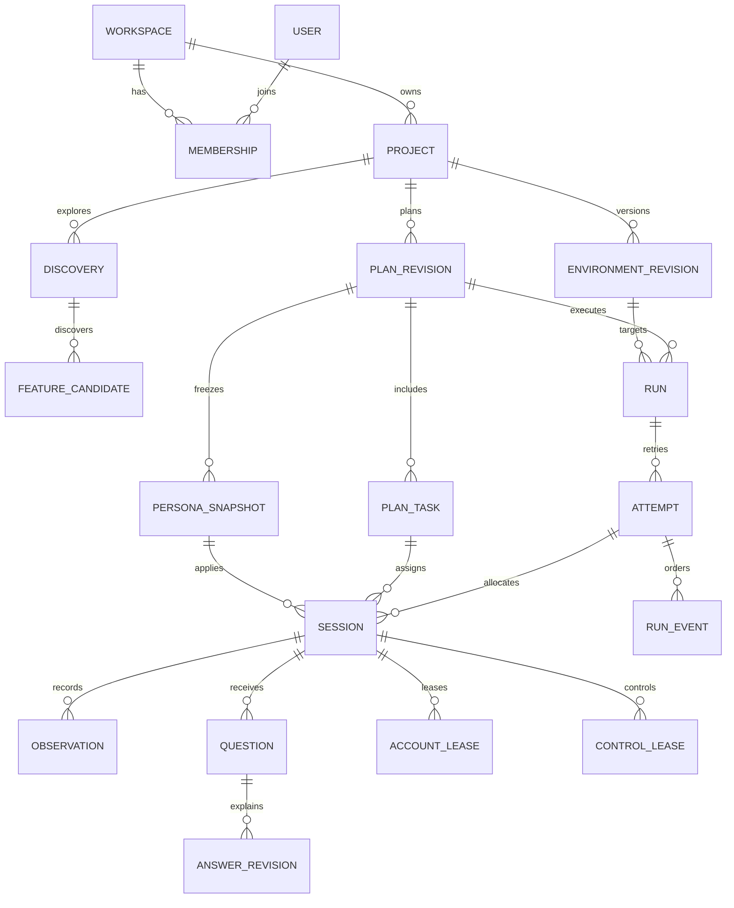
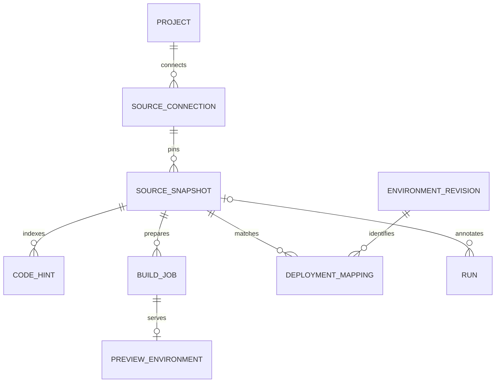
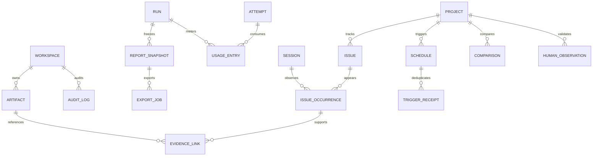

# ERD·캐시·메모리·토큰 설계 초안

- 연계: [기능명세서](../기능명세서.md), [API 계약](API_및_데이터_계약.md), [개발 백로그](개발_백로그.md)
- 상태: **설계 제안**. Django 모델/마이그레이션·Redis·운영 캐시·토큰 최적화가 구현됐다는 뜻이 아니다.
- 원칙: URL-only와 source-connected가 같은 프로젝트/계획/실행/리포트 구조를 사용한다. 코드는 선택 관계다. 이미지·코드 원문·영상은 DB의 큰 JSON에 넣지 않는다.

## 1. 핵심 실행 ERD

도식의 선택 관계는 아래 제약으로 보완한다. ACCOUNT_LEASE는 실행 준비 때 먼저 만들 수 있어 session 참조를 비워둘 수 있다. 시작 화면 준비용 browser lease와 실행 session의 lease는 용도로 구분한다.

| 엔터티 | 주요 필드/관계 | 제약·역할 |
|---|---|---|
| User / Membership | user, workspace, role, status | `(workspace_id,user_id)` unique. 초대/탈퇴/권한 변경 이력 별도 |
| Project | workspace, name, input_mode, archived_at | workspace 소유. 입력 방식과 runtime 분리 |
| EnvironmentRevision | project, environment_key, revision, runtime, entry_url, allowed_origins, safety_policy_revision | 같은 환경의 불변 revision. 실제 비밀값 제외. ready/expired/unsupported 명시 |
| Discovery | project, environment_revision nullable, source_snapshot nullable, state, limits, started/finished | 코드만 읽을 때 환경이 없을 수 있음. GUI 실행 가능과 분리 |
| FeatureCandidate | discovery, stable_key, label, source_kind, confidence, confirmation | 별도 근거 참조. source_kind=`screen/code/user`, confirmation/추정 신뢰도는 다른 필드 |
| PlanRevision | project, plan_key, revision, discovery, audience_json, state, confirmed_by/at, policy_versions | confirm 뒤 불변. 변경은 새 revision. 기능 선택/성공 조건/한도 snapshot |
| PlanTask | plan_revision, task_key, goal, success_rule, initial_state, action_policy, readiness | `(plan_revision_id,task_key)` unique. 다대다 기능 연결은 PlanTaskFeature로 분리 |
| PersonaSnapshot | plan_revision, profile_key, version, device, weights, context | 실행별 재현 가능한 문맥. 연령만으로 weights 변경 금지 |
| Run | workspace, project, plan_revision, environment_revision, state, idempotency_key, created_by, source_snapshot nullable | 계획/환경/코드 버전 고정. 요청 body hash와 idempotency를 함께 검사 |
| Attempt | run, number, state, heartbeat_at, worker_ref, cancellation_requested_at | `(run_id,number)` unique. 과거 실패/근거 보존 |
| Session | attempt, plan_task, persona_snapshot, state, last_observation, step_count, terminal_reason | task/profile은 해당 Run의 계획 소속이어야 함. terminal state와 기술 실패 원인 분리 |
| Observation | session, step, stage, observed_at, screenshot_artifact, viewport, signal_json, action_json | `(session_id,step)` unique. 입력 개인정보/토큰 제거. 대형 DOM/영상은 별도 artifact |
| RunEvent | attempt, session nullable, event_id, producer_id, producer_sequence, ingest_sequence, type, occurred/received_at, payload | event_id unique. attempt 수집 순서는 서버 직렬 부여. 큰 이미지/trace 원문 없음 |
| AccountLease | workspace, environment_revision, session nullable, secret_ref, provider_ref, purpose, expires_at, state | 비밀값 대신 참조. 계정별 쓰기 락·임대 유효성. 브라우저 context 격리와 별개 |
| ControlLease | session, holder_user, expires_at, state, version | 활성 제어권 최대 1개. 만료/연결 종료 시 복구 |
| Question / AnswerRevision | session, author, text, state / method, policy_version, answer, source_refs, usage_ref | 답변 이력·근거·미확인 표시. raw chain-of-thought 저장하지 않음 |

## 2. 코드·실행 준비 ERD

| 엔티티 | 주요 필드 | 제약·역할 |
|---|---|---|
| SourceConnection | project, provider, repository_ref, credential_ref, granted_scope, status | source token은 secret store. 해제 시 신규 fetch 차단·캐시 제거 |
| SourceSnapshot | connection, commit_sha, subdirectory, tree_digest, index_version, state | 동일 commit/path/인덱서 버전으로 증분 재사용. 접근권 검사와 데이터 내용 캐시는 분리 |
| CodeHint | snapshot, file_path, line_range, kind, summary, evidence_hash | 기능/과업 단서. 화면 검증을 대체하지 않음. 코드 본문 최소 보존 |
| BuildJob | snapshot, approved_recipe_revision, state, secret_refs, quota, started/finished, failure_code | 읽기와 실행 승인 분리. 격리된 worker만 실행 |
| PreviewEnvironment | build_job, environment_revision, endpoint_ref, expires_at, state | 만료/삭제/워커 실패 시 리소스 정리. 임의 주소를 신뢰하지 않음 |
| DeploymentMapping | environment_revision, snapshot, status, method, verified_at | matched/unverified/mismatched. 매핑 근거가 없으면 현재 배포 원인으로 확정하지 않음 |

URL-only에서는 SourceConnection/Snapshot이 없어도 공통 흐름이 성립한다. 코드 연결이 만료돼도 과거 Run의 snapshot ID는 바뀌지 않으며 실제 코드 열람은 현재 접근권으로 다시 검사한다.

## 3. 근거·리포트·운영 ERD

| 엔티티 | 주요 필드 | 제약·역할 |
|---|---|---|
| Artifact | workspace, owner_kind/참조 FK, kind, object_key, sha256, bytes, dimensions, masking_revision, state, expires_at | 원문 아닌 객체 저장소 참조. owner는 run/build/source 중 명시 관계와 check constraint로 제한. DB 조회만으로 모든 파일 접근을 허용하지 않음 |
| EvidenceLink | occurrence, observation, artifact, region_json, evidence_kind | 같은 근거가 여러 이슈를 뒷받침 가능. screenshot/bbox/설명 출처 대응 |
| Issue / IssueOccurrence | project, issue_key, reviewed_state / session, task, stage, category, detector_version, confidence | 실행 간 동일성은 대응 가설. unique task/stage 문자열만으로 영구 동일 이슈 확정 금지 |
| ReportSnapshot | run, revision, status, sealed_at, schema_version, content_hash, counts, data_ref | `(run,revision)` unique. partial/final·분모·근거 상태 고정. 수정 시 새 revision |
| ExportJob | report_snapshot, format, locale, renderer_version, state, artifact, failure_code | 동일 입력 생성 중 중복 방지. 파일 만료/권한과 캐시 적중은 별도 |
| UsageEntry | run, attempt, session nullable, purpose, provider, request_id, token categories, browser_seconds, cost_status | 호출/재시도별 원장. 추정/확정/공급자 확인 필요 구분 |
| Schedule / TriggerReceipt | project, plan_ref, environment_ref, timezone, enabled / trigger_id, payload_hash, received_at | webhook 중복·예약 중복 방지. 실행 시 최신 준비/권한 확인 |
| Comparison | project, base_report, target_report, rule_version, comparable, reason | 비교 조건 차이·미실행·기술 실패 처리. 확정 근거 보존 |
| HumanObservation | project, anonymous_participant, task_revision, condition_revision, outcome, stage/cause, dataset_split | 참여자×과업 중복·보정용/평가용 분리. 실제 사람 관측만 입력 |
| AuditLog | workspace, actor, action, resource_ref, request_id, occurred_at | 권한/실행/삭제/비밀값 접근/재처리 기록. 비밀값/코드 원문 제외 |

## 4. DB와 파일 저장 설계

- 자주 조회하는 키/상태/시각/소유권/버전은 관계형 컬럼. 유동적인 관측 신호·정책 snapshot만 크기 제한 JSON으로 저장한다.
- PNG·PDF·영상·대형 DOM·소스 번들은 객체 저장소. API는 기본적으로 메타데이터·짧은 설명·권한 참조만 반환한다.
- 모든 자식 리소스는 최종 workspace까지 검사한다. 조인 최적화를 위해 workspace_id를 중복 저장하면 부모와 일치하도록 서비스/DB 검사한다.
- 이미지/코드 중복 제거는 기본적으로 **workspace 범위**다. 다른 고객에게 hash 적중 여부를 노출하지 않는다.
- 이벤트는 append 중심, 상태/최근 관측/집계는 별도 materialized projection으로 관리한다. 한 화면 갱신 때 매번 전체 이벤트를 재집계하지 않는다.
- 우선 인덱스 후보: `Run(workspace,created_at,id)`, `Session(attempt,state,id)`, `RunEvent(attempt,ingest_sequence)`, `Observation(session,step)`, `IssueOccurrence(project,task_key,observed_at)`, `Artifact(workspace,state,expires_at)`, `UsageEntry(run,purpose,created_at)`.
- 실제 쿼리·카디널리티·실행계획으로 인덱스를 확정한다. 무조건 모든 JSON 키에 인덱스를 만들지 않는다. 이벤트 partition/집계 DB 분리는 측정 후 도입한다.
- 삭제는 DB만 cascade하지 않는다. 실행/lease 정지→객체/캐시/preview 정리→완료 표시의 재시도 가능한 삭제 작업을 둔다. 보존·감사 요구는 PO와 확정한다.

## 5. 캐시 설계

아래 수명은 방향이며 최종 TTL 수치는 부하/데이터 민감도 측정 뒤 정한다. 캐시는 권한 판정의 최종 원장이 아니다.

| 대상 | 캐시 키 구성 | 무효화/재검사 | 저장/주의 |
|---|---|---|---|
| 공개 제품 자산 | content hash·build version | 새 build | CDN/브라우저 장기 캐시. 고객 근거와 분리 |
| 프로젝트/권한 요약 | workspace·user·membership_version | 권한/멤버십 변경 즉시, 중요 요청은 DB 재검사 | Redis 짧은 수명. signed URL 발급 시 현재 접근권 확인 |
| URL 준비 결과 | workspace·environment_revision·정책 버전 | TTL/주소·redirect·정책 변경, 실제 실행 전 재확인 | DNS/인증·소유권 판단을 장기 캐시로 대신하지 않음 |
| 기능 탐색 | workspace·environment revision·start checkpoint·source snapshot·탐색기 버전 | 화면/배포/로그인 상태·source 변경 | private Redis/object cache. 캐시 결과임과 관측 시각 표시 |
| 코드 인덱스 | workspace·repo·commit·path·indexer version | commit/권한/해제/인덱서 변경 | 변경 파일만 증분 처리. 원문을 Redis에 전부 넣지 않음 |
| 계획 제안 | workspace·근거 hash·목표·정책/모델/프롬프트 버전 | 근거/목표/정책/타겟 변경 | 실행 승인/최종 계획을 과거 캐시로 자동 확정하지 않음 |
| Run 상태/집계 | workspace·run·projection_version | 이벤트 반영 시 단조 증가 version | DB snapshot + Redis hot projection. cache miss면 DB 복구 |
| 세션 미리보기 | workspace·session·observation_id·size·masking revision | 새 관측/마스킹 변경/삭제 | immutable thumbnail. 전체 원본 대신 목록용 크기 제공 |
| 리포트/PDF | workspace·report_revision·content hash·locale·renderer/masking version | 새 report revision/마스킹/삭제/renderer 변경 | object storage. 접근 URL은 별도 짧은 수명으로 발급 |
| 질문 답변 | workspace·session·observation cutoff·question hash·설명 정책/모델 버전 | 관측/정책 변경 | 종료 기본 이유 재사용. 실행 중 같은 질문도 관측이 달라지면 새 답변 |
| 모델 prefix | model/prompt version·허용된 공통 prefix | 공급자/모델/프롬프트 변경 | 공급자가 지원하는 경우만 사용량으로 확인. 적중/할인 보장하지 않음 |

캐시하지 않을 것: 브라우저 행동의 완료 결과를 새 실행의 결과로 재사용, 고객 쿠키/비밀번호의 일반 캐시, 테넌트 없는 코드/화면/질문 캐시, 프론트 localStorage의 공급자 키, 만료된 계정 준비를 ‘준비됨’으로 유지하는 결과.

동시 miss는 single-flight/분산 lock으로 하나의 작업만 생성하되 lock TTL·worker 장애 복구·중복 결과 무해성을 갖춘다. Redis 장애가 DB 기록/권한을 잃게 만들지 않는다. 키에 raw URL query·질문 원문·비밀값을 넣지 않고 canonical hash를 사용한다.

## 6. 메모리·동시성·화면 전송

### 에이전트/워커

- 브라우저 비용은 프로세스 수만 아니라 page/context·viewport·영상·스크린샷·대형 DOM에 좌우된다. 세션별 RSS와 provider resource를 측정한다.
- 동시에 띄울 세션 수는 queue admission으로 제한한다. 현재 데모의 최대 3개와 목표 50개 총 세션을 혼동하지 않는다. 전역/워크스페이스/계정/provider별 제한을 따로 둔다.
- 세션 전체 history를 메모리에 끝없이 누적하지 않는다. 최근 관측 ring buffer + 단계 요약 + 외부 저장소의 원본 참조로 구성한다.
- 이미지 base64와 원본 bytes를 중복 보유하지 않는다. 캡처→업로드→메타데이터 전달 후 버퍼를 해제하고 모델 입력용 변환도 크기/수명을 제한한다.
- 종료/예외/취소 때 자신이 만든 page/context/provider session만 닫는다. 공유 브라우저 전체를 닫아 다른 고객 세션을 끊지 않는다.
- 모델/업로드가 느릴 때 큐·backpressure로 캡처 속도를 제한한다. ‘프레임 저장→모델 요청’ 무제한 병렬화를 금지한다.

### 백엔드/프론트

- Django 목록 응답에 전체 trace·base64·전체 질문 이력을 넣지 않는다. summary/list/detail/events/observations를 분리하고 cursor로 받는다.
- 활성 Run만 적응형 polling 또는 SSE를 유지한다. 탭 비활성/접속 종료 시 구독을 정리하고 재접속에는 cursor를 쓴다.
- 보드에는 thumbnail과 최근 상태만 받는다. live stream은 선택한 1개 세션 중심으로 연결하고 상세를 닫으면 해제한다.
- FE는 카드/이벤트 목록 가상화·lazy image·동일 데이터 재렌더 방지·object URL revoke·타이머/리스너 cleanup을 적용한다.
- PDF/코드 인덱싱/빌드는 웹 요청 프로세스와 별도 자원 한도의 worker pool로 분리한다. 큰 파일은 스트리밍 업로드/다운로드한다.
- OOM/브라우저 crash/worker_lost는 UX 이탈이 아니다. 부분 근거를 보존하고 재시도는 새 attempt로 실행한다.

## 7. 토큰·모델 비용 설계

현재 페르소나 대시보드는 고정 규칙이고 모델 호출 0회다. 아래는 모델 정책을 붙일 때의 설계다. 현재 토큰 절감률/모델 품질 실측이 있다는 뜻이 아니다.

### 호출 단계와 문맥 분리

| 단계 | 전달할 것 | 빼거나 제한할 것 |
|---|---|---|
| 기능/과업 준비 | 사용자 목표·선별 화면/라우트·권한 있는 코드 단서 | 저장소 전체·node_modules·빌드 산출물·비밀 파일·중복 페이지 |
| 세션 행동 | 현재 화면·보이는 요소·활성 과업·직전 행동·진행 요약·허용 행동 | 전체 코드·다른 고객/세션 기록·정답 경로·기대 이탈점·모든 과거 이미지 |
| 종료 설명 | 해당 관측/동작·종료 상태·신호·정책·근거 참조 | 전체 live trace·고객 심리 추정·불필요한 이미지 재전송 |
| 리포트 | 구조화된 관측/집계·대표 문제 근거·불확실성 | 각 세션 전체 history를 다시 합친 giant prompt |

- 먼저 규칙/구조화 집계로 처리 가능한 것은 모델을 호출하지 않는다. 현재 ‘왜 멈췄나요?’ 기본 답변도 기록 규칙을 재사용한다.
- 긴 history는 단계별로 요약하되 goal/성공 증거/실패/미확인/금지 행동/최근 변경은 보존한다. 요약은 원본 evidence ID로 되돌아갈 수 있어야 한다.
- 코드 연결은 파일 인덱스→관련 경로 검색→필요 구간 조회 순서다. 검색 recall을 점검하고 코드 단서가 실제 화면 검증을 대체하지 않게 한다.
- 화면 해상도/압축/관심 영역은 가독성과 bbox 정합성을 보존하는 범위에서 조정한다. crop으로 CTA/경고/문맥을 잃는지 고해상도 기준과 비교한다. 원본 근거는 별도 보존한다.
- 중복 DOM/화면 hash와 단계 진전으로 불필요한 재호출을 줄이되 클릭 후 결과를 다시 관측하지 않고 성공 처리하지 않는다. 이미지가 같아도 상태가 같다는 보장은 없다.
- 출력 schema와 action 수를 제한하고 응답 토큰 상한·재시도 횟수·총 실행 예산을 둔다. 모델 전환/fallback이 있으면 이력을 남기고 품질 평가에 포함한다.

### 예산과 사용량 원장

`Run budget → purpose(탐색/행동/설명/리포트) → session → request` 단위로 예약/사용/반환한다. 모델 호출 직전 잔여 한도를 검사하고 근접하면 문맥 축소/중단을 정책에 따라 선택한다. budget_exceeded를 사용자 이탈로 바꾸지 않는다.

- 기록: provider/model/version, prompt/template hash, input/output tokens, cache-read/cache-write 등 공급자 usage, 이미지 개수/크기, request/retry ID, latency, purpose, error, price_table_revision.
- 텍스트 길이 기반 사전 추정과 공급자 실측을 구분한다. 이미지 토큰은 공급자 집계가 있을 때 그 값을 기록하고 추정식만으로 확정 과금하지 않는다.
- cached input이 total input에 포함되는지 공급자 계약에 맞춰 정규화한다. prompt total + cached를 단순 합산해 이중 계산하지 않는다.
- 네트워크 timeout 뒤 실제 청구 여부는 미확정일 수 있다. 요청 ledger를 남기고 추정/정산/확인 필요 상태를 둔다. 재시도가 무료라고 가정하지 않는다.
- 가격을 프론트에 하드코딩하지 않는다. 버전 있는 서버 가격표로 계산하고 실제 청구와 차이는 조정 내역으로 남긴다.
- 품질/안전 회귀 없이 줄었는지 동일 과업·동일 조건 baseline과 비교한다. 토큰만 적고 실패/금지 행동이 늘어난 변경은 승격하지 않는다.

## 8. 최적화 수용 항목

| ID | 담당 | 작업·측정 | 완료 기준 |
|---|---|---|---|
| PERF-01 | BE+FE | summary/detail 분리·cursor·incremental event | 세션 수/행동 수 증가에 따라 첫 목록 payload가 전체 trace 크기로 증가하지 않음. 누락/중복 복구 시험 |
| PERF-02 | FE | 카드/타임라인 가상화·thumbnail·단일 stream | 대표 장치에서 렌더 시간·heap·전송량 측정. 팝업 반복 개폐 후 구독/메모리 누수 없음 |
| PERF-03 | AG+BE | 브라우저/worker 동시성·backpressure | 부하 단계별 RSS/p95 queue wait/crash 측정. OOM 시 격리/자원 회수·타 고객 영향 시험 |
| PERF-04 | AG | 선택 문맥·단계 요약·출력 한도 | 호출별/과업별 input/output·성공/중단/안전·근거 완전성을 baseline과 비교 |
| PERF-05 | AG+BE | 토큰 예약/정산·재시도 상한 | 동시 호출에서도 run/purpose 예산 초과를 방지하고 cache/timeout/retry 비용 구분 |
| PERF-06 | BE+AG | 코드 증분 인덱스·관련 구간 검색 | 같은 commit 재요청은 불필요한 fetch/분석 감소, 변경 파일 반영·권한 해제 무효화 시험 |
| PERF-07 | BE | 캐시 key/무효화·single-flight | warm/cold latency·hit ratio·메모리·stale율 기록. 다른 tenant/권한/버전 혼입 0건 |
| PERF-08 | BE | PDF 비동기 생성·동일 revision 재사용 | 중복 요청 단일 job, API 메모리 상한·PDF 크기/시간·만료/마스킹 후 재생성 시험 |
| PERF-09 | BE | 쿼리·인덱스·projection | endpoint별 쿼리 수/실행계획/p95 측정. 카드 수만큼 N+1 쿼리 증가 없음 |
| PERF-10 | 전원+PO | 비용/품질/대기 수용 기준 | 측정 환경·동시성·데이터 크기·cold/warm·품질 기준과 결과를 함께 남김 |

성능 기준 숫자는 측정 후 합의한다. ‘캐시 적용=최적화 완료’, ‘50개 카드 표시=50개 브라우저 운영 가능’, ‘토큰 감소=품질 개선’으로 판정하지 않는다.

## 9. 검증 순서와 산출물

1. 기준 데이터: 짧은/긴 과업, 작은/큰 화면, 공개/인증 화면, 정상/실패/재시도, source 유무. 사람 검증 데이터와 최적화 fixture를 구분한다.
2. baseline: API payload/query, queue wait, browser/worker RSS, FE heap, stream/이미지 바이트, 모델 tokens/latency/과업 결과, PDF 시간/크기를 기록한다.
3. 한 번에 한 최적화 또는 원인이 분리되는 묶음을 적용한다. warm/cold·같은 조건 비교와 부작용 시험을 남긴다.
4. 권한 변경/배포/마스킹/삭제/worker 장애 시 stale cache·중복 job·누수·예산 정산을 검사한다.
5. 성능 리포트에는 구성/버전/측정 명령/표본 수/분포/실패/비용/품질 변화를 함께 기록한다. 측정 전 목표를 실측처럼 발표하지 않는다.
