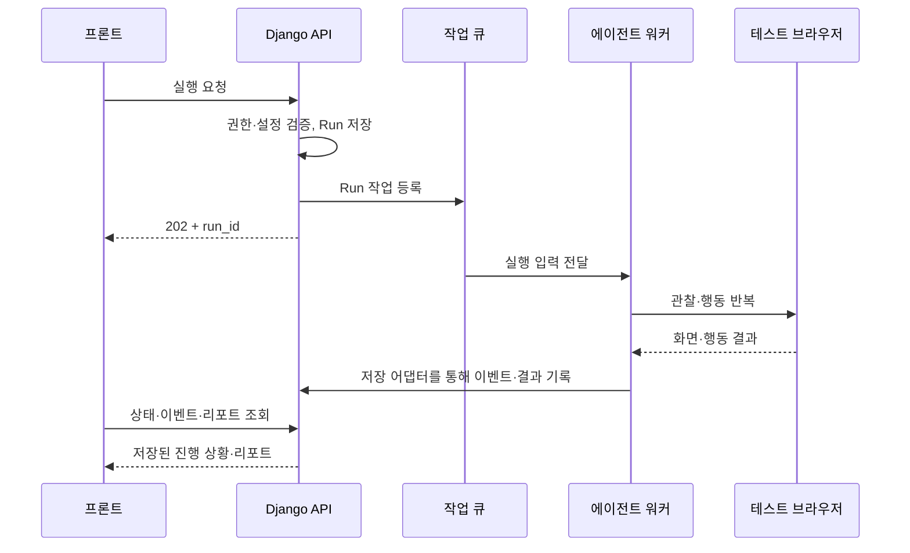

# DropSpot 개발 역할 분담 및 진행 방식

> 이 문서는 초기 역할 논의 기록입니다. 최신 제품 범위·상세 책임·우선순위는 [기능명세서](기능명세서.md), [개발 백로그](docs/개발_백로그.md), [API 계약](docs/API_및_데이터_계약.md), [ERD·성능 설계](docs/ERD_및_성능설계.md)를 우선합니다. 아래 초기 MVP 수량·API 예시를 현재 확정 계약으로 사용하지 않습니다.

- 작성일: 2026-11-03
- 전제: Django 백엔드 / 프론트엔드 / PO / 에이전트 담당으로 나누어 진행한다.
- 에이전트 담당: 본 문서 요청자.
- 상태: 팀 협의를 위한 실행 초안. 아래 API·폴더·기본값은 제안이며 구현 완료 상태가 아니다.
- 관련 문서: [AI 구현 가능성 검토](./AI_구현_가능성_검토.md)

## 1. 이번 개발의 목표

**URL·목표·타겟 입력 → 페르소나 생성 → 실제 브라우저 실행 → 마찰·종료 결과 수집 → 근거가 붙은 리포트**를 하나의 흐름으로 완성한다.

첫 MVP는 팀이 관리하는 데모 사이트, 과업 1개, 페르소나 4종, 총 8~20세션으로 제한한다. 강제 가입·뒤늦은 배송비·찾기 어려운 CTA를 우선 점검한다. 결과는 가상 사용자 조건에서의 진단이며 실제 고객 이탈률 예측으로 표시하지 않는다.

가장 먼저 맞출 것은 역할별 세부 구현보다 **실행 입력·이벤트·결과 형식**이다. 이 규격과 예시 데이터를 공유하면 각 담당자가 상대 구현을 기다리지 않고 개발할 수 있다.

## 2. 역할별 책임

| 영역 | Django 백엔드 | 프론트엔드 | PO | 에이전트 담당 |
|---|---|---|---|---|
| 제품 범위 | 구현 비용·제약 제시 | 화면 비용·제약 제시 | MVP 범위·우선순위 결정 | 실행 가능 범위·한계 제시 |
| 테스트 시나리오 | 설정 저장·검증 | 입력·선택 UI | 목표·성공 조건·문제 사례 정의 | 성공 조건을 실행 판정 규칙으로 구현 |
| 페르소나 | 패널 저장·조회 | 카드·분포 표시 | 세그먼트·행동 가정 승인 | 스키마·생성·분포 샘플링·행동 제약 |
| 실행 요청 | 인증·권한·Run 생성·큐 등록 | 실행 요청·중복 클릭 방지 | 실행 기본값·사용 흐름 결정 | 실행 입력 검증·런타임 구현 |
| 브라우저 | 워커 배포·자원·네트워크 정책 | 실행 진행 화면 | 데모 사이트 요구사항 | Playwright·모델 연결·관찰·행동·종료 |
| 실행 로그 | 이벤트 저장·조회·중복 제거 | 상태·타임라인 표시 | 사용자에게 필요한 정보 선정 | 이벤트·스크린샷·신호 생성 |
| 진단 | 근거·이슈 저장 | 근거·원인·개선안 표시 | 원인 정의·심각도·표현 검토 | 마찰 판정·원인 가설·개선안 생성 |
| 집계 | 퍼널·상태별 건수·리포트 API | 차트·분모·미완료 표시 | 지표 정의 승인 | 단계 도달·종료 이벤트의 정확성 |
| 검증 | 권한·저장·작업 생명주기 | 화면·오류·재조회 | 수용 기준·데모 검수 | 실행 안정성·오탐·증거·비용 측정 |

**제품 데이터와 공개 API는 Django가 소유하고, 에이전트는 실행 입력을 받아 이벤트와 결과를 내보낸다.** 프론트가 에이전트를 직접 호출하거나 에이전트가 프론트 전용 응답을 따로 만드는 구조는 피한다.

### Django 백엔드가 할 일

- 프로젝트·Run·페르소나 스냅샷·세션·스텝·이슈·아티팩트의 저장 구조.
- 사용자 인증과 프로젝트별 접근 권한, 실행 대상 URL 검증.
- 실행 생성·조회·취소 API, 큐 등록, 실행 상태 관리.
- 워커 이벤트 수집·검증·중복 제거와 결과 저장.
- 스크린샷 업로드 경로와 권한이 적용된 조회 URL 제공.
- 원시 이벤트에서 퍼널·종료 상태별 수치를 계산하는 공통 집계.
- 타임아웃·워커 중단 감지·재시도 정책·배포 환경.

### 프론트엔드가 할 일

- URL·목표·타겟·세션 수를 입력하는 화면.
- 페르소나 카드와 실행 전 설정 확인.
- 대기·실행·분석·완료·실패 상태와 진행 건수 표시.
- 세션 목록, 행동 타임라인, 스크린샷 근거 보기.
- 퍼널·세그먼트별 결과·원인 가설·개선안 Top 3 표시.
- 일부 세션 실패, 빈 리포트, 재조회·새로고침, 취소 상태 처리.
- 문제·개선 버전의 데모 사이트 구현. 별도 담당자가 있다면 해당 담당으로 이관.

### PO가 할 일

- 이번 MVP에서 보여줄 문제와 제외할 기능 결정.
- ‘첫 주문 완료’의 정확한 의미와 퍼널 단계 정의.
- 페르소나 4종의 목표·맥락·행동 가정과 초기 수치의 가설 성격 명시.
- 7개 원인 분류 기준과 대표 예시, ‘불명’ 처리 기준 작성.
- 데모 사이트에 심을 문제·개선 버전·정상 대조 경로의 요구사항 작성.
- 기능별 수용 기준·사용자 문구·심각도 기준 검토.
- 실제 실행 결과로 발표 스토리를 구성하고 가상 예시와 실측을 구분.

PO는 ‘에이전트가 이탈해야 하는 비율’을 지정하지 않는다. 발견할 문제와 검증 기준을 정의하고 결과는 실행에서 얻는다.

### 에이전트 담당이 할 일

- 페르소나·실행 설정·행동·이벤트·결과 스키마 초안 작성.
- 브라우저 관찰 → 모델 판단 → 허용 행동 실행 → 결과 확인 루프.
- 화면에 보이는 정보 범위, 기억, 행동 예산, 반복 탐색 제한 설계.
- 필드 수·추가 비용·되돌아가기·오류·지연 등 마찰 신호 수집.
- 좌절 수치 갱신과 가상 이탈·성공·기술 실패의 분리.
- 근거 스텝에 연결된 원인 가설·발화·개선안 생성.
- 모델·프롬프트·모형 버전·시간·토큰·비용 기록.
- 로컬 실행 도구와 공유용 샘플 결과 제공, Django 워커와 연동.

## 3. 권장 구조: Django + 별도 에이전트 워커



Django 요청 안에서 브라우저 실행이 끝날 때까지 기다리지 않는다. Python 에이전트 패키지를 별도 워커 프로세스에서 실행하는 구성을 우선 제안한다. MVP부터 별도 FastAPI 서비스를 추가할 필요는 없다.

큐·워커 운영은 백엔드가, 실행 함수 내부는 에이전트 담당이 맡는다. 저장 어댑터는 백엔드가 구현하며, 같은 저장소라면 Django 서비스 함수를 통해 DB에 기록한다. 이후 독립 배포가 필요할 때 내부 이벤트 API 등으로 교체할 수 있도록 경계를 둔다.

프론트 진행 표시는 우선 상태·이벤트 폴링으로 연결하고, 필요할 때 스트리밍을 추가한다. UI는 저장된 상태로 복원되어야 한다.

## 4. 먼저 합의할 연동 규격

### 4.1 실행 입력

외부 API에는 사용자가 URL·목표·타겟을 입력한다. 아래는 Django가 설정을 확정한 후 워커에 넘기는 내부 입력 예시다. ID는 Django가 발급하며 모든 실행에 스키마 버전을 남긴다.

```json
{
  "schema_version": "1.0",
  "run_id": "run_demo_001",
  "target_url": "https://demo.example.com/problem",
  "allowed_origins": ["https://demo.example.com"],
  "scenario": {
    "id": "first_order_v1",
    "goal": "첫 모의 주문 완료",
    "funnel_steps": ["landing", "product", "cart", "signup", "checkout", "complete"],
    "success_rule": {"type": "url_path", "value": "/order/success"}
  },
  "panel": {
    "target_description": "반찬 구독을 고려하는 1~2인 가구",
    "persona_template_version": "v1",
    "segment_ids": ["commuter", "comparison", "low_literacy", "early_adopter"],
    "session_count": 8,
    "seed": 42
  },
  "limits": {"max_steps": 30, "max_session_seconds": 180, "concurrency": 2},
  "config_version": "agent-config-v1"
}
```

- 기본값은 시작 제안이다. 한 세션 실측 후 조정한다.
- `success_rule`은 서버에서 허용한 종류로 검증한다. 임의 코드·스크립트를 입력받지 않는다.
- 테스트 계정이 필요하면 비밀값 자체 대신 서버가 해석하는 참조를 사용하고 공개 응답·로그에서 제외한다.
- 패널 생성 후 실제 페르소나와 세션 ID를 스냅샷으로 저장한 뒤 실행한다. 전후 비교는 seed만 재사용하지 않고 이 스냅샷을 재사용한다.
- `signup`처럼 건너뛸 수 있는 단계는 시나리오 정의에 선택 경로를 둔다. 비회원 주문을 개선했는데 회원가입 미도달을 실패로 계산하면 안 된다.

### 4.2 이벤트

```json
{
  "schema_version": "1.0",
  "event_id": "evt_001",
  "run_id": "run_demo_001",
  "session_id": "session_001",
  "attempt_id": "attempt_001",
  "sequence": 7,
  "occurred_at": "2026-11-03T01:00:00Z",
  "type": "step.completed",
  "payload": {
    "step_id": "step_004",
    "funnel_step": "signup",
    "action": "click",
    "observation": "가입 화면에 필수 입력 필드 8개가 노출됨",
    "signals": [{"type": "required_fields", "value": 8}],
    "frustration_score": 62,
    "artifact_ids": ["artifact_001"]
  }
}
```

최소 이벤트 종류는 `panel.created`, `session.started`, `step.completed`, `session.finished`로 시작한다. 워커 생존 확인은 별도 heartbeat로 전달한다.

- `event_id`로 중복 수신을 제거하고, attempt별 `sequence`로 정렬한다.
- 업로드 완료된 아티팩트만 링크한다. 업로드 실패는 누락 상태로 기록한다.
- `panel.created`에는 확정된 페르소나와 세션 목록을 담는다.
- `session.finished`에는 종료 상태·종료 이유·최종 단계·사용량을 담는다.
- 재시도는 `attempt_id`를 새로 발급한다. 채택된 최종 attempt만 집계하고 이전 로그는 보존한다.

### 4.3 상태 정의

Run과 개별 세션 상태를 분리한다.

| Run 상태 | 의미 |
|---|---|
| `queued` | 실행 대기 |
| `running` | 패널 생성 또는 세션 실행 중 |
| `analyzing` | 세션 종료 후 집계·진단 저장 중 |
| `completed` | 필수 결과·리포트 저장 완료. 개별 실패가 있으면 별도 요약 |
| `failed` | 작업 진행 또는 필수 리포트 생성 실패 |
| `cancelled` | 취소 처리 완료 |

세션은 실행 중 상태 외에 `success`, `simulated_dropout`, `agent_failure`, `site_failure`, `blocked_auth`, `budget_exceeded`, `cancelled`로 종료한다. 가상 이탈은 의도된 종료 결과이고 워커 실패와 다르다.

Run 상태 전이는 Django가 최종 관리한다. 워커가 죽으면 heartbeat와 작업 제한 시간으로 미종료 세션을 정리한다. 취소 요청은 플래그로 전달하고 에이전트가 스텝 사이에서 확인한다. 브라우저·모델 호출에 제한 시간을 두고 강제 종료된 attempt도 남긴다.

### 4.4 결과 책임

| 결과 | 생성 주체 | 검증·저장 주체 |
|---|---|---|
| 페르소나·패널 스냅샷 | 에이전트 | Django |
| 행동·단계 도달·마찰·종료 이벤트 | 에이전트 | Django |
| 화면 파일 | 에이전트 업로드 | Django가 메타데이터·조회 권한 관리 |
| 원인 가설·가상 발화·개선안 | 에이전트 분석 함수 | 스키마·근거 참조는 Django, 내용 검수는 PO |
| 퍼널 인원·종료 상태별 수치·빈도 | Django 집계 | 백엔드·PO |
| 표시 문구·차트 | 프론트 | PO |

퍼널 도달 수는 선택된 attempt에서 세션별 최초 도달을 기준으로 중복 없이 계산한다. 동일 세션이 가입 화면을 세 번 방문했다고 세 명으로 집계하지 않는다. 여러 원인이 붙을 수 있으므로 원인별 빈도의 합이 이탈 세션 수와 같을 필요는 없다.

원인 가설은 최소 `issue_id`, `category`, `summary`, `evidence_step_ids`, `recommendation`을 포함한다. 근거가 부족하면 원인을 ‘불명’으로 남긴다. 심각도 기준은 PO와 합의하고 관측 빈도와 구분한다.

### 4.5 프론트용 API 초안

| 요청 | 목적 | 담당 |
|---|---|---|
| `POST /api/runs` | 입력 검증·실행 생성, `202`와 ID 반환 | Django |
| `GET /api/runs/{run_id}` | 상태·진행 건수·실패 요약 | Django |
| `GET /api/runs/{run_id}/sessions` | 패널·세션별 상태 | Django |
| `GET /api/runs/{run_id}/events?after={cursor}` | 커서 이후 이벤트 조회 | Django |
| `GET /api/runs/{run_id}/report` | 집계·이슈·개선안 조회 | Django |
| `POST /api/runs/{run_id}/cancel` | 취소 요청 | Django |

세션 상세·아티팩트 조회 방식과 페이지네이션도 첫 연동 전에 정한다. 리포트 준비 전 응답, 접근 권한 오류, 중복 실행 요청의 처리 형식을 예시 데이터에 포함한다. 공개 API의 최종 스키마와 프론트용 mock 응답은 백엔드가 관리한다.

## 5. 진행 순서와 단계별 산출물

고정 일정보다 아래 완료 조건을 기준으로 진행한다. 실제 팀 일정에 맞춰 각 단계를 시간 단위로 배치한다.

| 단계 | PO | 백엔드 | 프론트 | 에이전트 | 완료 조건 |
|---|---|---|---|---|---|
| 0. 범위·규격 | 과업·문제 3종·성공 조건 | 공개 API·상태 초안 | 필요한 화면·응답 필드 | 내부 입력·이벤트 초안 | 같은 샘플 JSON으로 용어·ID·상태 합의 |
| 1. 독립 개발 | 데모 요구사항·검수표 | mock 결과를 저장·조회 | mock 응답으로 화면 구현 | 로컬 브라우저 1세션 실행 | 각자 단독 실행 가능 |
| 2. 첫 통합 | 사용자 흐름 검수 | 실행 요청 → 워커 → 결과 저장 | 실행 → 완료 → 근거 표시 | 실제 이벤트·화면 전달 | 실제 1세션을 UI에서 확인 |
| 3. 진단 | 발화·원인·심각도 검수 | 집계·이슈 API | 퍼널·세션·이슈 화면 | 페르소나 제약·마찰·종료 판정 | 증거가 있는 문제 진단 |
| 4. 확대·복구 | 우선순위 정리 | 큐·타임아웃·취소·중복 제거 | 부분 실패·재조회 | 4종 패널·소규모 동시 실행 | 8~20세션의 상태가 모두 정리됨 |
| 5. 데모 고정 | 발표·수용 기준 확인 | 배포·원본 데이터 보존 | 전후 비교·표시 검수 | 반복 평가·버전 고정 | 문제·개선·대조 경로 결과 확보 |

**첫 통합 시점에는 실제 실행 1세션만 연결한다.** 페르소나 생성, 병렬화, 진단, 스트리밍을 모두 완성한 뒤 통합하려 하면 규격 오류를 늦게 발견한다.

## 6. 에이전트 담당의 작업 순서

### A1. 입력·출력과 샘플을 먼저 만든다

- `RunInput`, `Persona`, `AgentEvent`, `SessionResult`, `Issue` 정의.
- 성공·가상 이탈·기술 실패 샘플을 각각 제공.
- 백엔드와 ID·상태·근거 참조·재시도 단위 합의.

완료 조건: 백엔드는 샘플을 저장할 수 있고, 프론트는 해당 결과가 어떻게 보일지 확인할 수 있다.

### A2. 모델 연결 전 브라우저 기반을 확인한다

- 데모 URL 접속, 화면 저장, 클릭·입력, 결과 확인.
- 세션마다 쿠키·장바구니·계정 상태 격리.
- 성공 조건과 업로드·정리 절차 확인.

이 단계의 고정 경로 자동화는 실행 환경 점검용이다. 최종 데모에서는 모델이 실제 관찰을 받아 행동을 선택하는 흐름과 구분한다.

### A3. 모델 행동 루프를 연결한다

- 보이는 요소와 화면을 관찰 입력으로 구성.
- 허용 행동만 구조화 출력으로 반환.
- 실행 전 대상 확인, 실행 후 상태 확인.
- 반복·스텝·시간·호출 예산 제한.

완료 조건: 새로운 세션에서 모델이 실제 행동을 선택하고 전체 궤적을 재검토할 수 있다.

### A4. 페르소나와 마찰을 연결한다

- 처음에는 고정된 4종 템플릿으로 실행 제약 검증.
- 같은 화면에서 조건에 따라 행동·종료가 달라지는지 확인.
- 마찰 수치는 코드로 계산하고 LLM 판단 신호와 구분.
- 이후 자연어 타겟에서 템플릿·분포를 생성하는 기능 추가.

완료 조건: 같은 문제에 대한 결과 차이를 설정·이벤트로 설명할 수 있다. 특정 이탈률을 맞추기 위해 값을 조작하지 않는다.

### A5. 진단과 전후 평가를 붙인다

- 저장된 근거로 원인 가설·개선안 생성.
- 문제 없는 경로에서도 돌려 오탐 확인.
- 같은 패널 스냅샷으로 문제·개선 버전 반복 실행.
- 기술 실패율·근거 누락·소요 시간·호출량 기록.

완료 조건: 단순히 ‘리포트가 예쁘다’가 아니라 어떤 실행 근거로 진단했는지 설명할 수 있다.

## 7. 협업 규칙

- 스키마에 없는 필드가 필요하면 먼저 예시와 함께 변경한다. 합의 없이 enum이나 필드명을 바꾸지 않는다.
- 프론트 mock 응답과 에이전트 실행 fixture는 같은 의미의 데이터를 사용한다.
- 막힌 내용은 ‘필요한 입력 / 현재 가정 / 영향받는 작업 / 대체 진행’으로 공유한다.
- API·화면·에이전트 내부 리팩터링보다 실제 1세션의 연결을 우선한다.
- 모델 키와 테스트 계정은 서버 환경에서 관리한다. 프론트 번들·일반 로그에 포함하지 않는다.
- 이전 실행 결과를 발표에 활용할 경우 해당 실행 ID·일시를 표시한다. 라이브 결과와 섞지 않는다.
- 데모 사이트 정답 정보와 개선 전후의 예상 결론은 평가 측에 둔다. 행동 모델에 미리 주입하지 않는다.

권장 디렉터리 예시:

```text
dropspot/
  backend/                 # Django API·DB·큐 연동: 백엔드
  frontend/                # 제품 UI: 프론트
  agent/                   # 독립 실행 가능한 Python 패키지: 에이전트 담당
    schemas/
    runtime/
    personas/
    policies/
    analysis/
    adapters/              # 로컬 JSONL 등 실행 출력 어댑터
  contracts/               # 합의된 JSON Schema·샘플, 변경 시 관련 담당 검토
  fixtures/                # 성공·가상 이탈·실패 예시
  docs/                    # 시나리오·수용 기준·연동 문서
```

에이전트 내부 인터페이스 제안은 `execute_run(input, emit_event, artifact_store, should_cancel)`다. 로컬에서는 파일로 이벤트를 남기고, 통합에서는 백엔드가 제공한 어댑터로 저장한다. 장시간 작업 내부에서 전용 브라우저와 비동기 이벤트 루프를 관리하고 Django 요청 처리와 분리한다.

## 8. 첫 회의에서 정할 항목과 초기 가정

| 결정할 항목 | 현재 제안 | 최종 결정 주체 |
|---|---|---|
| 데모 사이트 담당 | 프론트, PO가 요구사항 작성 | 팀 |
| 과업·성공 조건 | 첫 모의 주문, 지정 성공 경로 도달 | PO + 에이전트 |
| 실행 대상 | 팀이 통제하는 사이트 1개 | PO + 백엔드 |
| 패널 | 4종·총 8세션부터 | PO + 에이전트 |
| 실행 예산 | 세션 30스텝·180초, 동시 2개부터 실측 | 에이전트 + 백엔드 |
| 모델·API 비용 | 기존 검토 문서의 후보 중 접근 가능한 1개로 기준선 생성 | 에이전트, 예산은 팀 합의 |
| 실행 배포 | Django와 분리된 Python 워커 | 백엔드 + 에이전트 |
| 진행 표시 | 폴링 먼저 | 백엔드 + 프론트 |
| 퍼널·분모 | 단계별 중복 없는 도달 수 + 전체 종료 상태 | PO + 백엔드 |
| 첫 통합 목표 | 실제 1세션 결과와 화면을 UI에서 조회 | 전원 |

## 9. MVP 완료 체크리스트

- [ ] PO가 목표·정상 경로·문제 3종·개선 경로를 문서화했다.
- [ ] Django가 실행을 생성하고 요청 응답 이후 워커에서 실행한다.
- [ ] 에이전트가 실제 화면을 보고 행동하며 근거를 남긴다.
- [ ] 프론트에서 상태·세션·퍼널·원인·스크린샷을 확인한다.
- [ ] 가상 이탈·기술 실패·미지원 인증·예산 초과·취소가 구분된다.
- [ ] 이벤트 재전달·작업 재시도가 퍼널 인원을 중복 증가시키지 않는다.
- [ ] 워커 중단 시 실행이 영구적으로 진행 중에 남지 않는다.
- [ ] 모든 이슈에 확인 가능한 근거가 있고 없는 원인을 단정하지 않는다.
- [ ] 문제·개선 버전을 반복 비교하고 실제 결과를 기록했다.
- [ ] 현재 결과가 시뮬레이션임을 화면과 발표에서 명시했다.

바로 착수할 작업은 **PO의 데모 시나리오, 백엔드의 Run·상태 API, 프론트의 샘플 기반 화면, 에이전트 담당의 스키마·로컬 1세션 실행**이다. 네 작업은 합의된 예시 데이터를 기준으로 함께 진행할 수 있다.
